<div align="center">

# Timbre

**Gestión de alquileres para dueños que administran sus propias casas, departamentos y galpones.**

Cobranzas, morosidad con aviso por WhatsApp, reclamos derivados al plomero en un clic y un portal para cada inquilino.

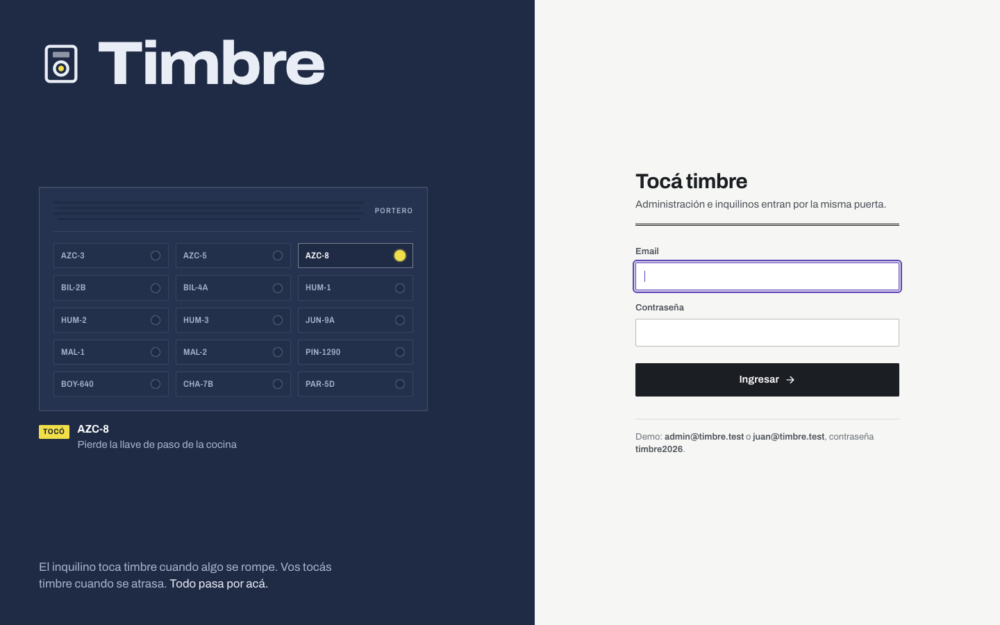


</div>

---

## ¿Por qué "Timbre"?

Porque suena para los dos lados: **el inquilino toca timbre** cuando algo se rompe y **vos tocás timbre** cuando se atrasa con el alquiler. Todo pasa por acá.

El panel está pensado como la **liquidación de expensas** que se pega en el hall del edificio: una fila por unidad, la deuda en su propia columna, un **resaltador amarillo** sobre lo que pide acción y un **sello violeta** que cae sobre lo que ya se cobró.

---

## Índice

- [Funcionalidades](#funcionalidades)
- [Capturas](#capturas)
- [Stack y arquitectura](#stack-y-arquitectura)
- [Instalación](#instalación)
- [Usuarios de demo](#usuarios-de-demo)
- [Estructura del proyecto](#estructura-del-proyecto)
- [API](#api)
- [Tests](#tests)
- [Sistema de diseño](#sistema-de-diseño)
- [Decisiones y notas](#decisiones-y-notas)

---

## Funcionalidades

### Para el dueño (panel de administración)

| Módulo | Qué resuelve |
|---|---|
| **Liquidación del mes** | La pantalla de inicio. Muestra esperado, cobrado y adeudado vencido, y una planilla por unidad con saldo anterior, cuota, pagos, intereses y saldo. **Los morosos van primero**, resaltados, con los botones **Cobrar** y **WhatsApp** en la misma fila. |
| **Cobros y recibos** | Pagos totales o parciales, interés por mora diario editable, recibos correlativos para imprimir o guardar en PDF, y anulación de pagos. |
| **Aviso por WhatsApp** | Un clic abre WhatsApp con el mensaje ya escrito: nombre, unidad, saldo, días de atraso y alias para transferir. Queda registrado quién fue avisado y cuándo. Usa links `wa.me`, sin API paga. |
| **Reclamos** | Tablero Abierto → Derivado → En curso → Resuelto, con fotos, prioridad y una conversación con el inquilino. |
| **Derivación al proveedor** | **Derivar** abre WhatsApp al plomero, gasista o electricista con la dirección, el inquilino, la falla y la prioridad ya escritos, y marca el reclamo como derivado. |
| **Comprobantes de pago** | El inquilino sube la captura de la transferencia y vos la revisás. **Confirmar y emitir recibo** registra el pago; si pagó de más, la diferencia queda como mora. También podés rechazarlo con un motivo. |
| **Propiedades** | Casas, departamentos y galpones con código corto (`AZC-8`), galería de fotos con portada y el resultado del año de cada unidad. |
| **Inquilinos** | Ficha con contratos, cuotas, avisos enviados, reclamos y acceso al portal. |
| **Contratos** | Vigencia, día de vencimiento, ajuste ICL/IPC/fijo, depósito y mora. Al crearlo se generan las cuotas solas, y el ajuste por porcentaje actualiza las cuotas futuras. |
| **Documentos** | Contrato firmado, DNI, garantía y recibos de sueldo en disco privado. Avisa cuando vence una garantía. |
| **Agenda del mes** | Calendario de vencimientos de cuotas, ajustes ICL/IPC, fines de contrato y documentos que vencen. |
| **Gastos y rentabilidad** | ABL, expensas, seguros y arreglos. El costo de un reclamo se carga solo como gasto. Calcula el neto y el margen de cada unidad, por año y mes a mes. |
| **Exportar para el contador** | Excel del mes con 3 hojas (liquidación, cobros y gastos) y un reporte imprimible en PDF. |
| **Buscador global** | **Ctrl+K** desde cualquier pantalla busca unidades, inquilinos y reclamos. |
| **Actividad** | Línea de tiempo de pagos, avisos, derivaciones, reclamos y comprobantes. |
| **Ajustes** | Datos de la administración, alias para transferir y los textos de los mensajes de WhatsApp, con vista previa. |

### Para el inquilino (portal)

- **Deuda clara:** cuánto debe vencido (con mora al día de hoy) y cuánto vence después, separados.
- **Sus cuotas:** cada una con su etapa (emitida → vence → vencida → pagada) y el recibo de cada pago.
- **Ya pagué: subir comprobante:** informa la transferencia con foto o PDF y sigue el estado.
- **Reclamos con fotos:** puede seguir cómo avanzan y conversar con la administración.
- **Alias para transferir** con botón de copiar, y acceso directo al WhatsApp de la administración.

### Tareas automáticas

Todos los días a las 06:00, `cuotas:generar` crea las cuotas del mes de cada contrato vigente y marca las vencidas.

---

## Capturas

<details open>
<summary><b>Liquidación del mes</b>: comprobantes para confirmar, reclamos sin derivar y la planilla con los morosos primero</summary>

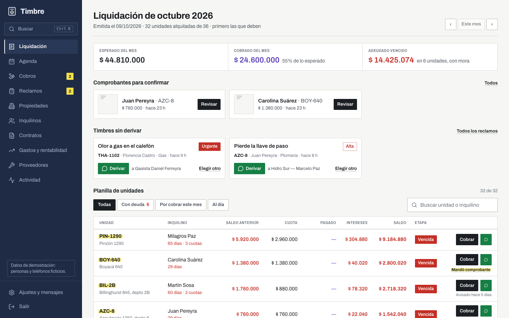
</details>

<details>
<summary><b>Registrar un cobro</b>: saldo, mora sugerida y pago parcial</summary>

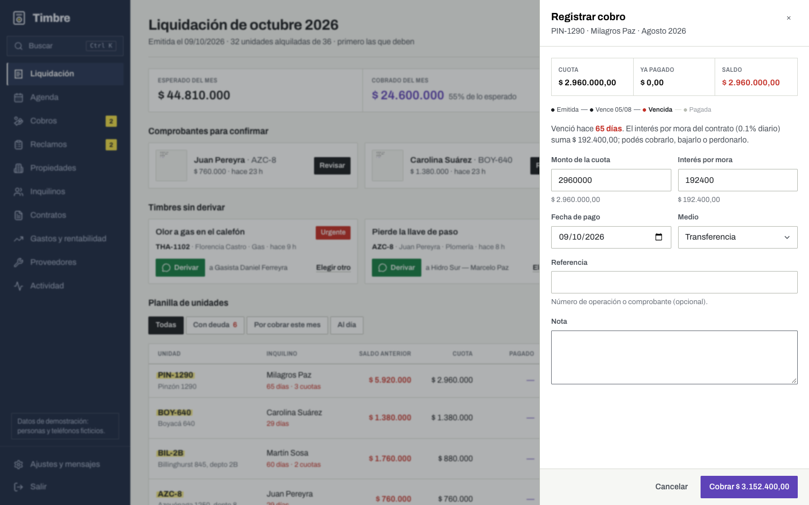
</details>

<details>
<summary><b>Revisar un comprobante</b> que mandó el inquilino</summary>

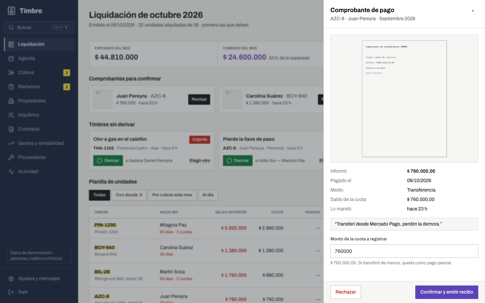
</details>

<details>
<summary><b>Reclamo con derivación en un clic</b> al proveedor del rubro</summary>

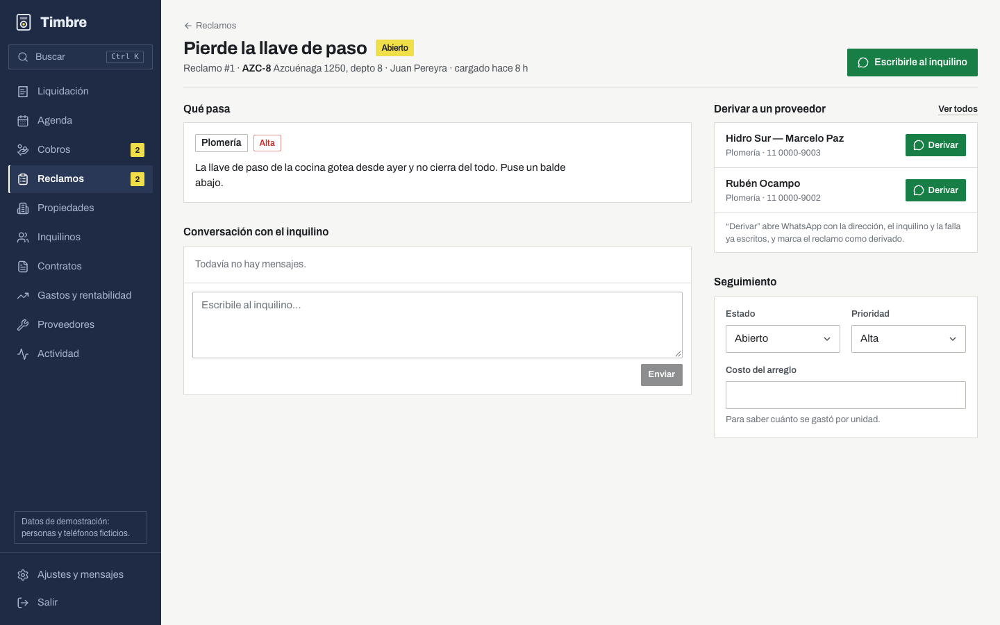
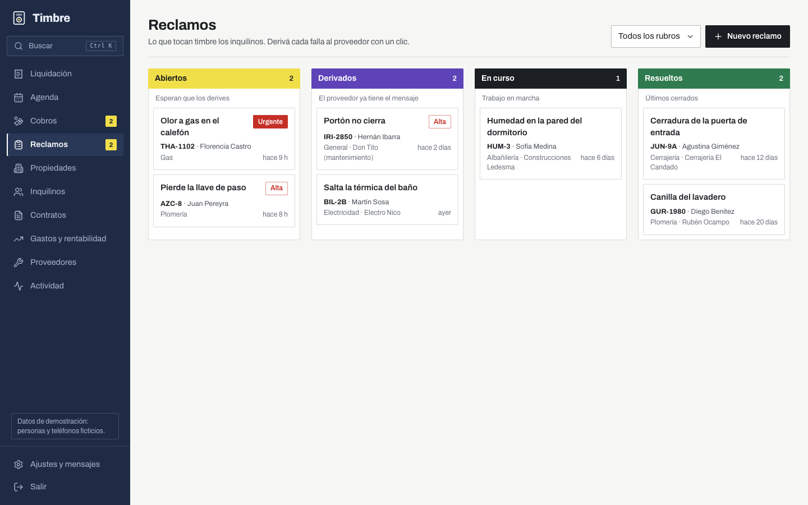
</details>

<details>
<summary><b>Buscador global</b> (Ctrl+K)</summary>

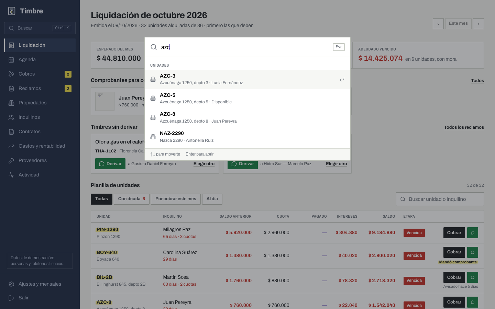
</details>

<details>
<summary><b>Agenda del mes</b></summary>

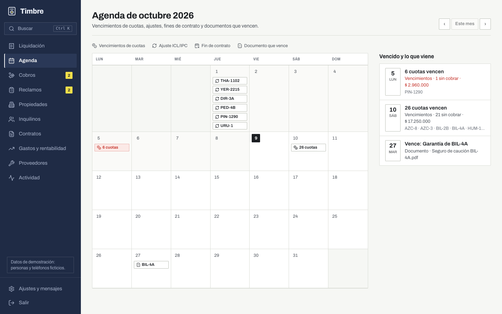
</details>

<details>
<summary><b>Gastos y rentabilidad</b> por unidad</summary>

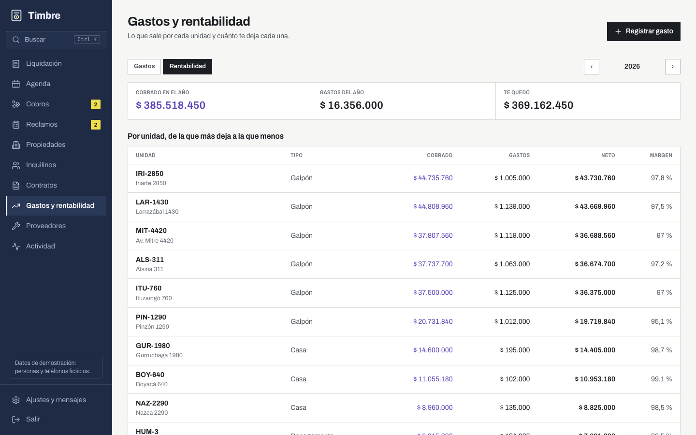
</details>

<details>
<summary><b>Contrato</b>: cuotas, recibos, documentos y ajuste ICL/IPC</summary>

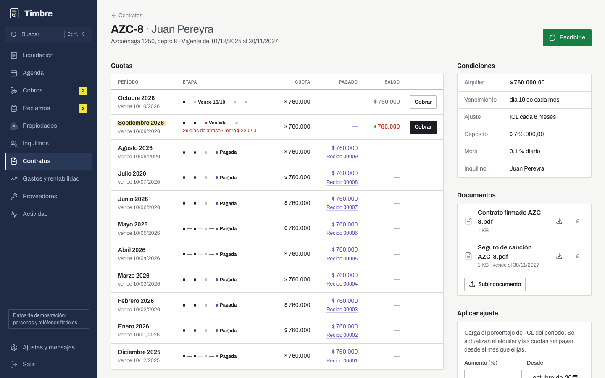
</details>

<details>
<summary><b>Propiedad</b>: fotos, contrato vigente y resultado del año</summary>

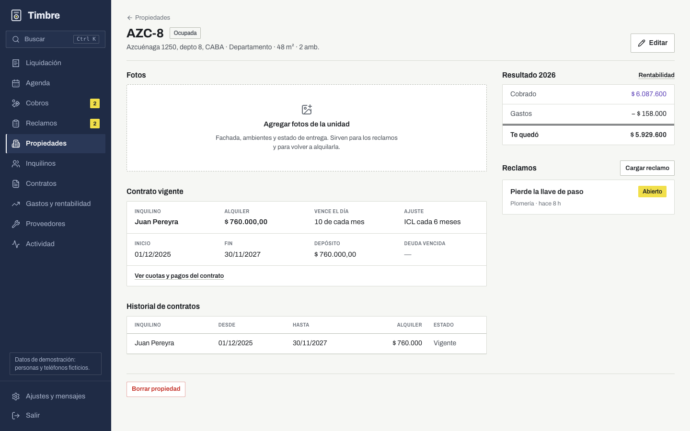
</details>

<details>
<summary><b>Actividad</b> y <b>reporte para el contador</b></summary>

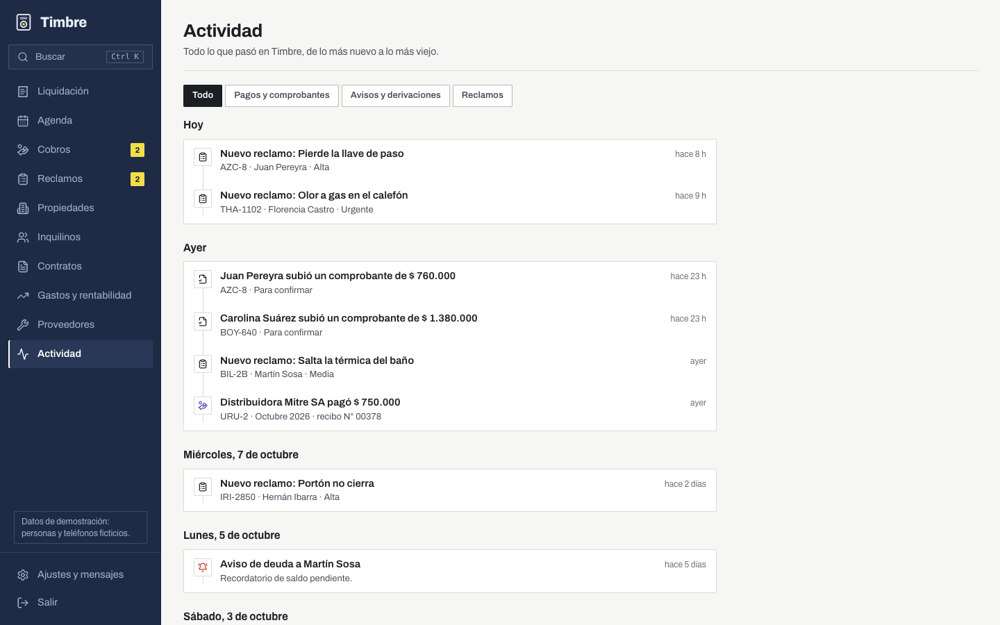
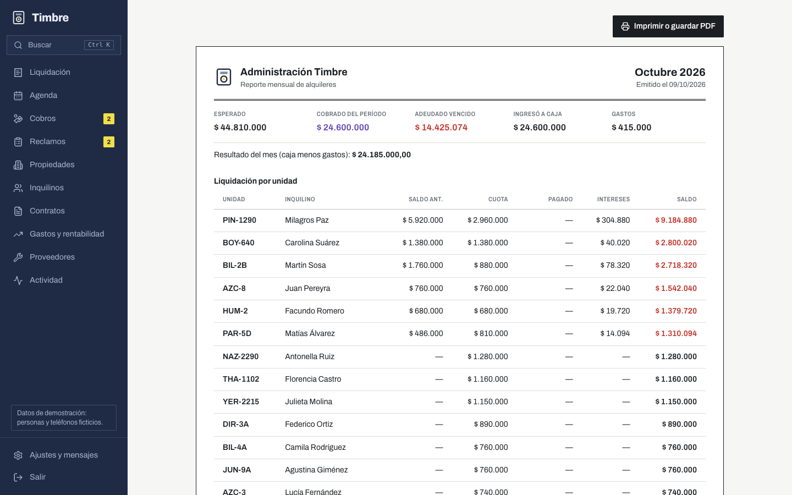
</details>

<details>
<summary><b>En el celular</b>: panel del dueño y portal del inquilino</summary>

| Liquidación | Agenda | Portal | Subir comprobante | Reclamos |
|---|---|---|---|---|
| 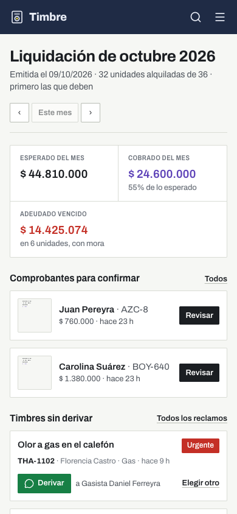 | 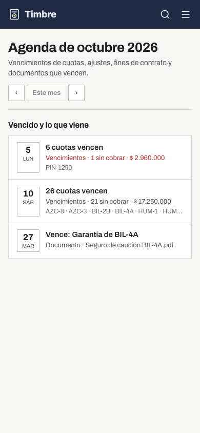 | 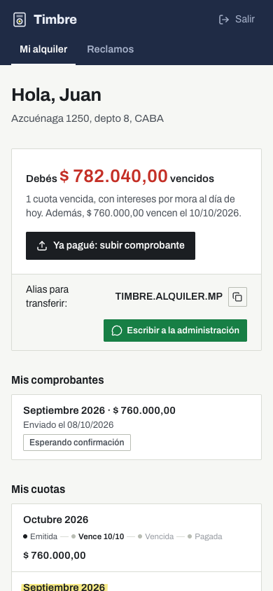 | 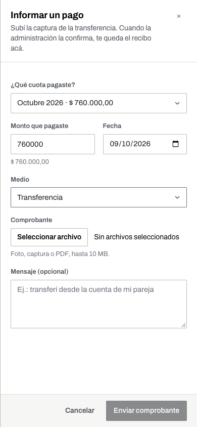 | 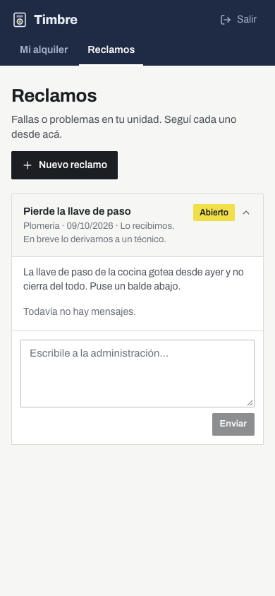 |
</details>

> Todas las personas, teléfonos y montos de las capturas son **datos de demostración ficticios**.

---

## Stack y arquitectura

| Capa | Tecnología |
|---|---|
| API | **Laravel 13** (PHP 8.5), Sanctum (tokens), Form Requests, API Resources, Enums, Scheduler |
| Base de datos | **PostgreSQL 17** |
| Frontend | **Next.js 16** (App Router, Cache Components, TypeScript), **Tailwind CSS 4**, lucide-react |
| Tipografía | Archivo (Omnibus-Type, Buenos Aires), con su eje de ancho |
| Excel | OpenSpout |
| Tests | PHPUnit (feature tests sobre Postgres) |

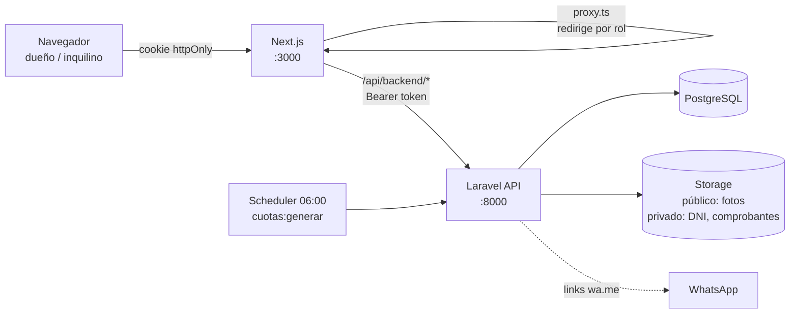

- **El token nunca llega al JavaScript del navegador.** Next.js lo guarda en una cookie `httpOnly` y reenvía cada llamada a Laravel desde un route handler (`/api/backend/[...path]`).
- **La autorización real está en Laravel.** Hay middleware de rol (`admin` / `inquilino`) y los endpoints del portal siempre quedan acotados al contrato del inquilino. `proxy.ts` solo hace la redirección optimista.
- **Archivos sensibles en disco privado.** DNI, garantías y comprobantes se sirven únicamente por un endpoint autenticado.

---

## Instalación

### Requisitos

- PHP 8.3+ con `pdo_pgsql`, `gd` e `intl`
- Composer 2
- Node.js 20+
- PostgreSQL 15+

### 1. Clonar

```bash
git clone https://github.com/eduwavee/timbreapp.git
cd timbreapp
```

### 2. Backend (Laravel)

```bash
cd backend
composer install
cp .env.example .env          # ajustá DB_USERNAME / DB_PASSWORD
php artisan key:generate
createdb gestoria
php artisan migrate --seed    # datos de demo
php artisan storage:link
```

### 3. Frontend (Next.js)

```bash
cd ../frontend
npm install
cp .env.example .env.local
```

### 4. Levantar todo

Desde la raíz:

```bash
./dev.sh
```

Arranca la API en `:8000`, el scheduler y el frontend en `:3000`. Abrí **http://localhost:3000**.

Para volver a los datos de demo: `cd backend && php artisan migrate:fresh --seed`.

---

## Usuarios de demo

| Rol | Email | Contraseña |
|---|---|---|
| Administración | `admin@timbre.test` | `timbre2026` |
| Inquilino (Juan, Azcuénaga 1250 depto 8) | `juan@timbre.test` | `timbre2026` |

Los datos de demo incluyen:
- **Cartera:** 36 unidades (CABA, Avellaneda y Lanús) y 32 contratos, con morosos, pagos parciales e historial de cobros.
- **Seguimiento:** reclamos en distintos estados, gastos, comprobantes para confirmar y documentos (uno de ellos, una garantía por vencer).

Los teléfonos usan la serie inexistente `11 0000-xxxx`, así que ningún WhatsApp de prueba le llega a un desconocido.

---

## Estructura del proyecto

```
timbreapp/
├── backend/                      Laravel 13
│   ├── app/Enums/                estados y rubros con etiquetas en español
│   ├── app/Http/Controllers/Api/ un controlador por recurso (+ Portal/)
│   ├── app/Http/Requests/        validaciones
│   ├── app/Http/Resources/       forma del JSON
│   ├── app/Models/
│   ├── app/Services/             Billing (cuotas, mora, recibos) y WhatsApp (links y mensajes)
│   ├── database/                 migraciones, factories y seeder de demo
│   ├── routes/api.php            65 rutas
│   └── tests/Feature/
├── frontend/                     Next.js 16
│   └── src/
│       ├── app/admin/            panel del dueño
│       ├── app/portal/           portal del inquilino
│       ├── app/login/            el portero eléctrico
│       ├── app/recibo/[id]/      recibo imprimible
│       ├── app/api/              login, logout y proxy hacia Laravel
│       ├── components/           sistema de componentes
│       ├── lib/                  cliente de API, formatos es-AR y tipos
│       └── proxy.ts              redirección por sesión y rol
├── docs/screenshots/
├── DESIGN.md                     sistema de diseño (tokens, reglas, componentes)
├── PRODUCT.md                    contexto de producto
└── dev.sh                        levanta todo
```

---

## API

Todas las rutas van bajo `/api`, con autenticación Sanctum (Bearer).

<details>
<summary><b>Ver los endpoints principales</b></summary>

**Sesión**

| Método | Ruta | |
|---|---|---|
| POST | `/login` | devuelve el token y el usuario con su rol |
| GET | `/me` · POST `/logout` | |

**Administración** (rol `admin`)

| Método | Ruta | |
|---|---|---|
| GET | `/ledger?period=YYYY-MM` | liquidación del mes: filas por unidad, totales, links de WhatsApp |
| GET | `/dashboard` | ocupación, cobranza de 6 meses, reclamos, comprobantes y vencimientos |
| CRUD | `/properties`, `/tenants`, `/contracts`, `/providers`, `/tickets`, `/expenses` | |
| POST | `/contracts/{id}/adjust` | ajuste por porcentaje o monto desde un período |
| GET | `/installments`, `/installments/{id}` | |
| POST | `/installments/{id}/payments` | registra un pago (parcial o total) y emite el recibo |
| POST | `/installments/{id}/reminder` | arma el aviso de WhatsApp y lo registra |
| POST | `/tickets/{id}/derive` | deriva al proveedor y devuelve el link de WhatsApp |
| GET/POST | `/proofs`, `/proofs/{id}/approve`, `/proofs/{id}/reject` | comprobantes de inquilinos |
| POST/PATCH/DELETE | `/properties/{id}/photos`, `/property-photos/{id}` | fotos |
| GET/POST/DELETE | `/contracts/{id}/documents`, `/documents/{id}/file` | documentos privados |
| GET | `/agenda?month=`, `/activity`, `/search?q=`, `/profitability?year=` | |
| GET | `/exports/month?month=YYYY-MM` | Excel del mes |
| GET/PUT | `/settings` | |

**Portal** (rol `inquilino`, siempre acotado a su contrato)

| Método | Ruta | |
|---|---|---|
| GET | `/portal/summary` | deuda, cuotas, comprobantes y datos para pagar |
| GET/POST | `/portal/tickets` | sus reclamos, con fotos |
| POST | `/portal/proofs` | informar un pago con comprobante |

</details>

---

## Tests

```bash
cd backend
createdb gestoria_test   # solo la primera vez
php artisan test
```

Hay 18 tests de feature (75 aserciones) que cubren:
- **Cobranza:** generación de cuotas, pagos parciales, numeración de recibos y mora diaria.
- **Liquidación:** totales vencidos sin las cuotas que todavía no vencieron y los links de WhatsApp.
- **Reclamos:** derivación al proveedor.
- **Permisos del inquilino:** solo ve lo suyo, no entra a rutas de administración y no puede ver archivos ajenos.
- **Comprobantes:** el flujo completo de comprobante → confirmación → recibo.
- **Gastos:** el costo de un reclamo se convierte en gasto.
- **Varios:** buscador, documentos privados con vencimiento en la agenda, exportación a Excel y normalización de teléfonos argentinos para WhatsApp.

---

## Sistema de diseño

El diseño se documenta en [`DESIGN.md`](DESIGN.md). Lo esencial:

- **Tres instrumentos, un trabajo cada uno:**
  - **rojo birome** para la deuda;
  - **resaltador amarillo** para lo que pide acción;
  - **sello violeta** para lo cobrado.
- **Cifras:** tabulares, alineadas a la derecha y en pesos enteros en planillas y resúmenes.
- **Construcción:** filetes de 1px y esquinas de 2px, con doble filete sobre los totales.
- **Una sola familia tipográfica** (Archivo), con rótulos condensados para las columnas.
- **WhatsApp verde** solo para los botones que abren `wa.me`.

---

## Decisiones y notas

- **WhatsApp sin API paga.** Cada aviso abre `wa.me` con el mensaje armado y lo mandás vos. No hace falta cuenta de Meta Business ni plantillas aprobadas.
- **Mora:** es un porcentaje diario sobre el saldo vencido, definido por contrato. Al cobrar se puede bajar o perdonar.
- **Teléfonos argentinos:** se normalizan para WhatsApp (`11 15 5555-1234` → `5491155551234`), incluidos códigos de área de 3 y 4 dígitos.
- **Zona horaria:** `America/Argentina/Buenos_Aires`.
- **Moneda:** ARS con formato `es-AR` (`$ 1.234.567`).

---

<div align="center">
Hecho en Argentina 🇦🇷
</div>
